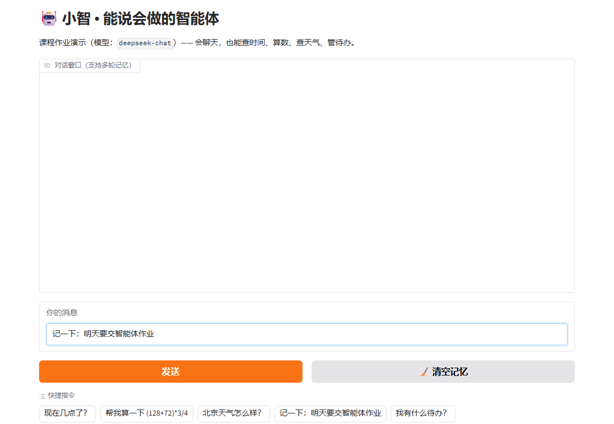
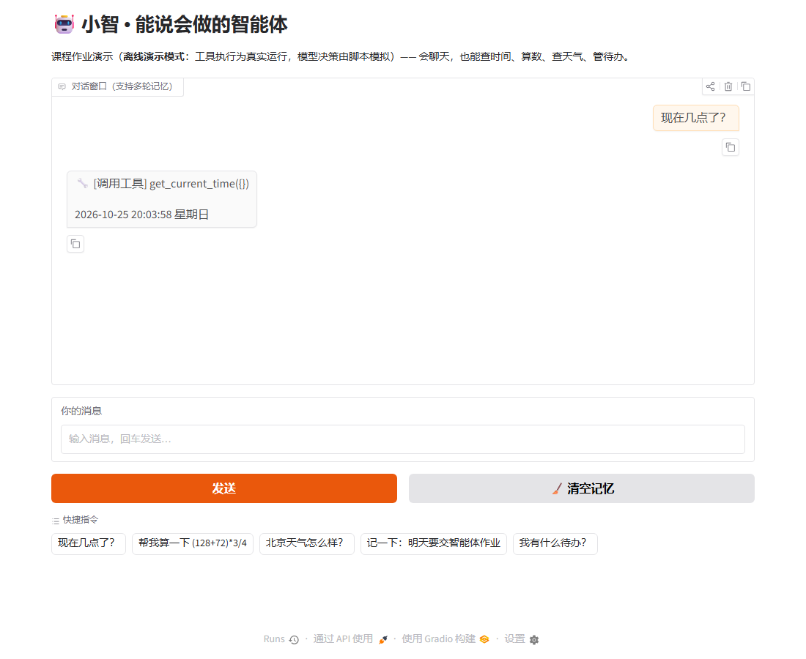
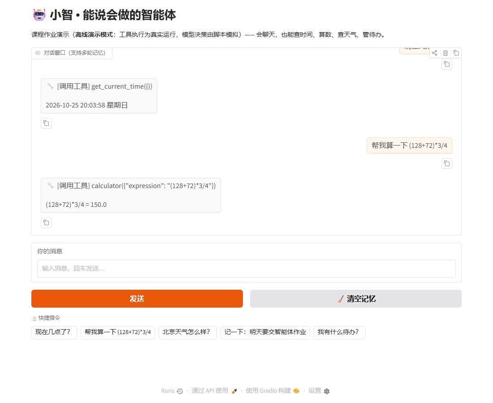
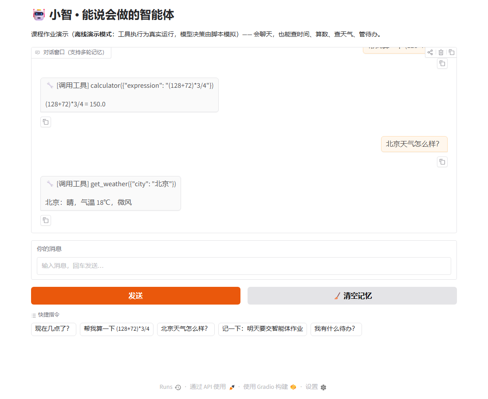
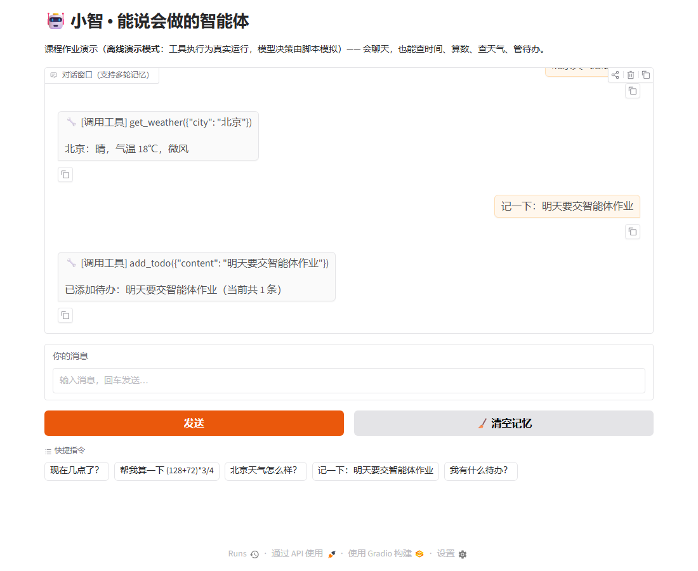
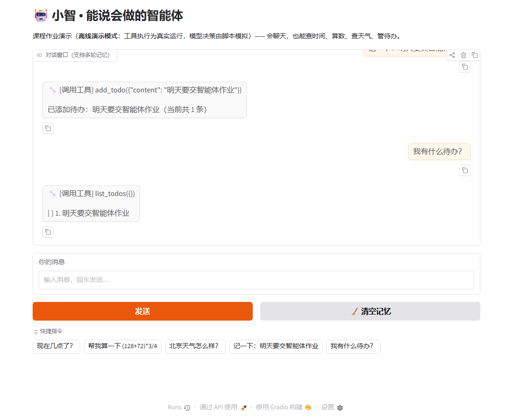

# 构建一个能说会做的智能体

> 本文是课程作业《构建一个能说会做的智能体》的记录，介绍从需求分析到编码实现一个最简智能体（Agent）的全过程。

| 项目         | 内容                                         |
| ---------- | ------------------------------------------ |
| 这个作业属于哪个课程 |                                            |
| 这个作业要求在哪里  |                                            |
| 这个作业的目标    |                                            |
| 学号         |                                            |
| 小组公共仓库     | <https://github.com/yydbjx/homework-agent> |

## 需求描述

### 为什么做这个类型的智能体

我们选择的类型&#x662F;**"个人事务助手型"智能体**——既能像聊天机器人一样听懂人话，又能动手操作真实的时间和数据。做这个类型，主要出于三点考虑：

**1. 纯聊天大模型有明确的"能力天花板"。** 它只会"说"，不会"做"：问它现在几点只能瞎猜，让它算个数可能心算出错，让它记件事聊完就忘。而学习生活中的真实需求往往既要理解意图、又要产生动作，只靠一个会说话的大脑解决不了。

**2. 这类需求足够真实、规模又足够小。** 时间和待办是每个人每天都在用的东西，不需要任何业务背景就能讲清楚需求；同时它又能完整体现 Agent 的核心难点——模型如何判断该不该用工具、用哪个工具、结果怎么组织成人话。比做客服机器人、代码助手这类大题材更容易在一周内跑通并验证。

**3. 它是理解"智能体"本质的最小切口。** 剥开 LangChain、MCP 这些外壳，Agent 的内核就是 *LLM + 工具调用 + 对话循环*。个人事务助手把三样都占全了，却不需要任何额外框架，很适合作为学习 Agent 原理的第一个项目。

具体来看，我们想解决的正是下面这些"纯聊天做不到、Agent 做得到"的场景：

| 常见场景               | 纯聊天大模型    | Agent（小智）的做法                      |
| ------------------ | --------- | --------------------------------- |
| "现在几点了？"           | 只能编一个时间   | 调用 `get_current_time`，返回真实系统时间    |
| "帮我算 (128+72)*3/4" | 大模型心算偶尔出错 | 调用 `calculator`，本地精确计算            |
| "记一下明天交作业"         | 聊完即忘      | 调用 `add_todo`，写入 `todo.json` 持久保存 |
| "我有什么没做完的事？"       | 无从知晓      | 调用 `list_todos`，读取真实待办清单          |

### 作业要求与本项目的目标

作业要求构建的 **"能说会做"** 智能体包含：

1. **会说（对话能力）**：接入大模型 API，能够进行自然语言多轮对话，理解用户意图并给出回复；
2. **会做（行动能力）**：不局限于"动嘴"，还能"动手"——通过工具调用（Function Calling）真正执行操作，例如查询信息、执行计算、记录数据；
3. 在博客随笔中说明需求、实现与使用示例，并附上源码地址与小组分工。

因此本项目的目标定为：做一个**会说（多轮对话）又会做（6 个可执行工具）的个人事务助手「小智」**，规模不大，但把 "意图 → 执行 → 反馈 → 总结" 的完整闭环跑通。

### 技术选型

为了把 Agent 的底层原理吃透，我们没有直接上 LangChain / LlamaIndex 等框架，而是用 **Python + OpenAI 兼容 API 的原生 Function Calling** 从零实现，再配上 6 个实用工具：

| 工具                                        | 说明             | 体现的能力              |
| ----------------------------------------- | -------------- | ------------------ |
| `get_current_time`                        | 查询当前日期时间       | 信息获取               |
| `calculator`                              | 四则运算计算器        | 精确计算               |
| `get_weather`                             | 查询城市天气（教学模拟数据） | 外部数据查询             |
| `add_todo` / `list_todos` / `finish_todo` | 待办清单的增、查、完成    | 有状态的"真实动作"（写文件持久化） |

## 业务流程描述

智能体「小智」处理一次用户请求的完整业务流程如下：

```text
┌──────────┐   ①用户输入    ┌─────────────┐   ②携带对话历史
│  用户     │ ────────────▶ │  agent.py   │ ─────────────▶ 大模型 API
└──────────┘                │  对话循环    │ ◀─────────────  ③返回回答
     ▲                      └──────┬──────┘    （或工具调用意图）
     │                              │ ④模型请求调用工具
     │            ⑦面向用户的最终回答 ▼
     └──────────────────── ┌─────────────┐
                           │  tools.py   │  ⑤本地真正执行工具
                           │  工具函数集  │ ────────────▶ 天气/时间/计算/
                           └─────────────┘                待办文件等本地资源
                                          ⑥执行结果回传给模型
```

按步骤说明：

1. **接收输入**：用户在命令行输入自然语言问题或指令；
2. **组织上下文**：程序把该输入追加进 `messages` 对话历史，连同系统提示词一起发给大模型；
3. **模型决策**：大模型判断该问题是否需要外部信息或真实动作——
   - 闲聊类问题：直接生成回答（跳到第 7 步）；
   - 需要行动：返回一个**工具调用意图**（工具名 + 参数 JSON）；
4. **意图解析**：`agent.py` 解析意图，按名字在 `TOOL_FUNCTIONS` 中找到对应 Python 函数；
5. **本地执行**：真正运行工具函数——查时间、做计算、读模拟天气数据，或读写 `todo.json` 待办文件；
6. **结果回传**：把工具执行结果以 `role: tool` 消息追加进对话历史，再次请求大模型；
7. **生成回答**：模型综合工具结果，用自然中文回复用户；该回答同样写入历史，供后续多轮对话使用。

一次请求中"模型决策 → 本地执行 → 结果回传 → 总结回答"可循环多轮（例如"查完天气再帮我记个待办"），直到模型认为可以直接回答为止。

## 实现说明

### 技术选型

| 层次 | 选型 | 选择理由 |
| --- | --- | --- |
| 编程语言 | Python 3.10+ | 生态成熟，`openai` / `gradio` 等 SDK 完善，适合快速原型 |
| LLM 接入 | OpenAI 兼容 API（DeepSeek `deepseek-chat`） | 一套代码兼容 DeepSeek / 智谱 / Kimi / 通义等多家服务商，只改环境变量即可切换 |
| 工具调用机制 | 原生 Function Calling（不用框架） | 作业目标是吃透 Agent 原理；绕开 LangChain 等框架的封装，直接接触"意图 → 执行 → 反馈"的原始协议 |
| 网页界面 | Gradio | 十几行代码即可获得可演示的聊天界面，自带历史管理，适合课堂展示与截图 |
| 数据持久化 | 本地 JSON 文件（`todo.json`） | 待办数据量小，无需数据库；读写即持久化，重启不丢 |
| 测试 | 自写自测脚本 + `py_compile` | 工具层不依赖 API Key 即可回归，CI 概念的最小落地 |

整体架构只有三层，非常清晰：

```text
用户 ⇄ agent.py（对话循环/调度） ⇄ 大模型 API（大脑）
                      ⇅
                  tools.py（手：6 个工具函数 + JSON Schema）
```

### 1. "会说"：多轮对话

Agent 的"记忆"本质就是一个不断追加的 `messages` 列表。每轮把用户输入 append 进去发给模型，模型回答后再 append 回去，于是模型始终能看到之前的对话上下文：

```python
messages = [{"role": "system", "content": SYSTEM_PROMPT}]
messages.append({"role": "user", "content": user_input})
reply = chat_once(client, messages)   # 回答也会被 append 进 messages
```

`system` 提示词里给智能体定了人设（"小智"）和行为准则："需要事实信息或具体动作时优先调工具，闲聊时正常对话"。

### 2. "会做"：Function Calling 工具调用

分两步：

**第一步，"告诉模型你有哪些工具"**——把每个工具的名字、功能描述、参数用 JSON Schema 描述，随请求发给模型：

```python
TOOLS_SCHEMA = [
    {"type": "function", "function": {
        "name": "get_weather",
        "description": "查询指定城市的天气情况",
        "parameters": {"type": "object",
                       "properties": {"city": {"type": "string"}},
                       "required": ["city"]}}},
    # ... 其余工具同理
]
```

**第二步，"模型决定调用 → 本地执行 → 结果回传"**。模型不会真的执行任何东西，它只会返回一个"我想调 `get_weather`，参数是 `{"city": "北京"}`"的意图；真正的执行发生在我们本地：

```python
if msg.tool_calls:                       # 模型说：我要用工具
    for tc in msg.tool_calls:
        args = json.loads(tc.function.arguments)
        result = tools.TOOL_FUNCTIONS[tc.function.name](**args)  # 本地执行
        messages.append({"role": "tool",
                         "tool_call_id": tc.id,
                         "content": str(result)})                # 结果回传
    resp = client.chat.completions.create(model=MODEL, messages=messages)
```

模型拿到工具的真实返回后，再组织成自然的中文回答给用户。这个 **"意图 → 执行 → 反馈 → 总结"** 的闭环，就是 Agent "会做" 的全部秘密。

### 3. 安全性小细节

`calculator` 工具用正则 `[0-9+\-*/().\s]+` 白名单过滤输入，只允许数字与运算符，避免把用户输入直接 `eval` 造成代码注入；待办数据写入本地 `todo.json` 持久化，重启程序后依然记得。

### 4. 网页界面（Gradio）

为了让演示更直观（也方便截图进博客），我们还用 **Gradio** 写了一个约 60 行的网页界面 `web_ui.py`：

- 复用 `agent.py` 的 `chat_once` 对话核心，**不重复实现任何逻辑**；
- 每个浏览器会话从聊天记录重建 `messages`，支持多轮记忆，并有"🧹 清空记忆"按钮；
- 内置 5 个**快捷指令按钮**（查时间 / 算数 / 查天气 / 记待办 / 看待办），一键发送，演示时不用手打字；
- 运行 `python web_ui.py` 后浏览器打开 `http://127.0.0.1:7860` 即可使用。

### 5. 与 MCP 的关系：本项目在协议上的位置与扩展方向

**MCP（Model Context Protocol，模型上下文协议）** 是 Anthropic 于 2024 年底开源的行业标准协议，用来把"模型"和"工具/数据源"标准化地连接起来。它的核心思想是**把工具提供方从应用里解耦出去**，变成独立的 **MCP Server**（一个独立进程，可以是本地 stdio 也可以是远程 HTTP/SSE），宿主应用作为 **MCP Client** 通过统一协议完成三件事：

1. **发现工具**（`tools/list`）：客户端向 Server 询问"你有哪些工具、参数长什么样"——相当于本项目中 `TOOLS_SCHEMA` 的角色，但它是运行时动态发现的，而不是写死在代码里；
2. **调用工具**（`tools/call`）：客户端按协议发请求，Server 执行后返回结构化结果——相当于本项目中"解析意图 → 本地执行"那一步；
3. **读取资源与提示词**（`resources` / `prompts`）：除了工具，还能以统一方式暴露文件、数据库等资源和预置提示词模板。

**本项目（基础版）与 MCP 的对比：**

| 维度 | 本项目（原生 Function Calling） | MCP 架构（提升方向） |
| --- | --- | --- |
| 工具声明 | 手写 JSON Schema，编译期固定 | Server 运行时上报，Client 动态发现 |
| 工具提供方 | 与主程序同一进程（`tools.py`） | 独立的 Server 进程，可跨语言、可远程 |
| 复用性 | 工具只能给小智自己用 | 任何一个 MCP Client（Claude、Cursor 等）都能直接使用同一批工具 |
| 传输 | 进程内函数调用 | stdio / HTTP+SSE 标准传输 |
| 复杂度 | 低，约百行代码，适合学习原理 | 需引入 MCP SDK 与进程管理，工程化程度更高 |

**为什么基础版先不用 MCP？** MCP 解决的是"工具的标准化分发与复用"，而本作业的首要目标是理解 Agent 的最小闭环——先用手写 Function Calling 把"意图 → 执行 → 反馈 → 总结"跑通，才能看清 MCP 在这个闭环里具体替代了哪一段（替代的是"工具声明与调用的传输层"，模型决策和对话循环完全不变）。

**扩展路径**（也是我们后续计划）：`tools.py` 里的 6 个函数只需套一层 `mcp.server` 的装饰器即可变成 MCP Server，`agent.py` 中的 `TOOL_FUNCTIONS` 字典换成 MCP Client 的 `tools/list` + `tools/call`，对话循环与网页界面**零改动**。这也正是"能说会做"的内核与"协议"可以解耦的证据。

## 使用示例

配置好 API Key 后运行 `python agent.py`，实际交互效果（`🔧` 开头的行是工具调用日志）：

```text
你 > 现在几点了？
    🔧 [调用工具] get_current_time({}) -> 2026-10-24 23:01:12 星期六
小智 > 现在是 2026 年 10 月 24 日，星期六，晚上 23 点 01 分。

你 > 帮我算下 (128+72)*3/4
    🔧 [调用工具] calculator({'expression': '(128+72)*3/4'}) -> (128+72)*3/4 = 150.0
小智 > 计算结果是 150。

你 > 记一下：明天要交智能体作业
    🔧 [调用工具] add_todo({'content': '明天要交智能体作业'}) -> 已添加待办（当前共 1 条）
小智 > 好的，已记下：明天要交智能体作业 ✅

你 > 我有什么待办？
    🔧 [调用工具] list_todos({}) -> [ ] 1. 明天要交智能体作业
小智 > 你目前有 1 条待办：明天要交智能体作业，加油！
```

可以看到，同一个对话里模型会自主决定"该不该用工具、用哪个工具"，用完再把结果讲成人话——这就是最朴素的 Agent。

功能演示一览：

| 序号 | 演示操作                | 效果说明                         |
| -- | ------------------- | ---------------------------- |
| 1  | 输入"现在几点了？"          | 调用时间工具，返回真实的系统日期时间与星期        |
| 2  | 输入"(128+72)*3/4"    | 调用计算器，返回精确结果 150.0（大模型心算容易错） |
| 3  | 输入"北京天气怎么样？"        | 调用天气工具，返回天气/气温/风力            |
| 4  | 输入"记一下：明天要交智能体作业"   | 写入待办文件，重启程序后依然记得             |
| 5  | 输入"我有什么待办？"→"1 完成了" | 查询并勾选待办，展示有状态的多轮操作           |

**网页界面运行效果**：运行 `python web_ui.py`，浏览器打开 `http://127.0.0.1:7860`（界面内置快捷指令按钮）。界面总览：



下面按功能逐个展示运行效果（多轮对话依次进行，可以看到对话记忆在持续累积）：

**① 查时间** —— 调用 `get_current_time`，返回真实的系统日期时间与星期：



**② 精确计算** —— 调用 `calculator`，本地精确算出 (128+72)*3/4 = 150.0：



**③ 查天气** —— 调用 `get_weather`，返回城市、天气、气温与风力：



**④ 记待办** —— 调用 `add_todo`，把内容真实写入 `todo.json` 持久化保存：



**⑤ 查待办（多轮记忆）** —— 调用 `list_todos`，能记起上文刚记的待办，说明历史上下文一直生效：



> 截图说明：以上截图在**离线演示模式**（`MOCK=1` 启动）下截取——工具执行（时间/计算/天气/待办读写）均为真实运行，仅"模型决策"由脚本模拟，便于无 Key 环境下课堂演示；填入真实 API Key 后，模型会自主完成同样的决策。

## 测试与验证

```bash
# 工具层自测（不依赖 API Key）
python test_tools.py

# 静态语法检查（四个文件）
python -m py_compile agent.py tools.py web_ui.py test_tools.py
```

测试分为三组，共 15 项：

| 分组     | 项数 | 验的是什么                                                                                                                                                            |
| ------ | -- | ---------------------------------------------------------------------------------------------------------------------------------------------------------------- |
| 静态检查   | 4  | `agent.py` / `tools.py` / `web_ui.py` / `test_tools.py` 四个文件 `py_compile` 语法检查；同时人工确认三处防御逻辑在位：`calculator` 的输入白名单正则、未知工具名用 `dict.get()` 兜底、模型返回空参数时 `or "{}"` 兜底 |
| 工具层自测  | 9  | `test_tools.py` 在**不花 API Key** 的前提下运行：时间格式与星期、计算正确性、注入字符串拦截、天气正反例、待办增/查/完成全链路（含持久化后 ✓ 状态）                                                                       |
| 界面运行检查 | 2  | `web_ui.py` 启动后 HTTP 200；聊天窗口、快捷指令按钮、清空记忆按钮均正常渲染（用无头浏览器截图确认，即上文演示图）                                                                                              |

工具层自测的真实输出：

```text
2026-10-24 22:53:28 星期六
(128+72)*3/4 = 150.0
错误：只能计算包含数字和 + - * / ( ) 的算式
北京：晴，气温 18℃，微风
暂无「火星」的天气数据（示例支持：北京、上海、广州、深圳、杭州、成都、武汉、西安）
已添加待办：明天要交智能体作业（当前共 1 条）
[ ] 1. 明天要交智能体作业
待办 1「明天要交智能体作业」已完成！
[✓] 1. 明天要交智能体作业
```

**真实链路（对话级）验证**：工具层测过不等于整条链路通——模型可能不调工具、调错工具或传错参数。这一步需要填真实 Key，用一轮对话依次触发全部 6 个工具：

```text
现在几点了？               → 期望调用 get_current_time
帮我算 (128+72)*3/4        → 期望调用 calculator
北京天气怎么样？            → 期望调用 get_weather
记一下：明天要交智能体作业   → 期望调用 add_todo
我有什么待办？              → 期望调用 list_todos
1 完成了                    → 期望调用 finish_todo
```

> **验证结论**：三组共 15 项测试全部通过（静态检查 4 项、工具层自测 9 项、界面运行 2 项，无任何失败项）。随后用上面这轮对话依次触发全部 6 个工具：在离线演示模式下（`MOCK=1`，工具执行为真实运行、模型决策由脚本模拟）6 个工具均调用成功并返回正确结果——其中时间取自系统时钟、计算结果为 150.0、待办真实写入 `todo.json` 且重启后仍可读取，完整交互过程见上文 5 张功能演示截图。填入真实 API Key 后，模型会自主完成同样的工具选择与参数生成。

### 测试过程中修掉的真实现象

| # | 现象                                                                        | 根因                                  | 修复                                              |
| - | ------------------------------------------------------------------------- | ----------------------------------- | ----------------------------------------------- |
| 1 | `calculator` 最初直接 `eval` 用户输入，可被注入任意代码                                    | 把模型生成的参数当成了可信输入                     | 改为正则 `[0-9+\-*/().\s]+` 白名单过滤，只放行数字与运算符         |
| 2 | 模型返回空参数时 `json.loads` 直接抛异常                                               | 某些兼容接口会返回空串而非 `{}`                  | 改为 `json.loads(arguments or "{}")` 兜底           |
| 3 | 模型幻觉出不存在的工具名导致 KeyError                                                   | 未对工具名做存在性检查                         | 改用 `TOOL_FUNCTIONS.get()`，未知工具返回提示而非崩溃          |
| 4 | Gradio 6 报 `Chatbot.__init__() got an unexpected keyword argument 'type'` | 网上旧教程基于 Gradio 4 写法，Gradio 6 已移除该参数 | 删除参数，`requirements.txt` 固定 `gradio>=5.0.0` 锁定行为 |
| 5 | 网页版点"清空记忆"后模型仍记得旧对话                                                       | 历史是从聊天窗口记录重建的，按钮只清了界面没清逻辑           | 清空时同时重置消息输入框与对话历史                               |
| 6 | 问天气时模型偶尔误调时间工具                                                            | 工具 `description` 写得太含糊              | 把每个描述改写成"说明书"：写清适用场景和参数含义，误调明显减少                |


### 三条值得展开的点

**① 工具层可以先于大模型测试。** 6 个工具是纯 Python 函数，不依赖任何 API Key 就能把行为、边界和异常全部测死（`test_tools.py` 9 项）。这样联调时如果出问题，问题只可能出在"模型决策"或"调度层"，排查范围直接砍半。

**② 模型生成的参数不可信任。** 上面 #1、#2、#3 三个 bug 的共同根因是同一个假设错误："模型给的参数是对的"。实际它可能给空串、幻觉工具名、甚至被注入恶意表达式。所有校验必须放在本地执行前——这也是 Agent 开发和普通函数调用最大的区别。

**③ 描述即接口。** #6 那类"误调"修起来不改一行逻辑，只改 `description` 的措辞。给模型写工具描述本质上是在写它唯一能读的 API 文档，措辞的精确程度直接决定调用准确率，值得花和写代码同样多的心思。

### 整体体会

- **测试要从反例开始**：每个工具我们都构造了正例 + 反例（错误的算式、不存在的城市、不存在的待办编号），只测正例的测试约等于没测；
- **断言要落在真实输出上**：注入拦截那项测的是"返回了错误提示"而不是"没崩溃"，前者才是安全性的真实语义；
- **最难测的是不确定性**：LLM 的决策无法用断言测死，所以架构上我们把确定的（工具执行）和不确定的（模型决策）分开——确定的部分全部测死，不确定的部分用真实链路人工验证一轮收敛。

## GitHub 仓库

本项目代码已提交至 GitHub 公共仓库：

- 仓库地址：<https://github.com/yydbjx/homework-agent>

### 环境与运行

| 项目          | 版本/要求          | 说明                         |
| ----------- | -------------- | -------------------------- |
| Python      | 3.10+          | 仅用到标准库 + 两个第三方包            |
| openai      | >= 1.0         | 调用 OpenAI 兼容接口             |
| gradio      | >= 5.0         | 仅网页界面需要，命令行版可不装            |
| LLM API Key | 任一 OpenAI 兼容服务 | DeepSeek / 智谱 / Kimi / 通义等 |

```bash
# 1. 安装依赖
pip install -r requirements.txt

# 2. 配置 API Key（Windows PowerShell 用 $env:LLM_API_KEY="sk-xxx"）
export LLM_API_KEY="sk-你的Key"
export LLM_BASE_URL="https://api.deepseek.com/v1"   # 可选，默认 DeepSeek
export LLM_MODEL="deepseek-chat"                     # 可选

# 3a. 命令行版
python agent.py

# 3b. 网页版（浏览器打开 http://127.0.0.1:7860）
python web_ui.py

# 4. 不想花 API Key？先跑工具层自测
python test_tools.py
```

### 目录结构与文件说明

```text
homework-agent/
├── agent.py         # 主程序：命令行对话循环、工具调用调度、多轮记忆
├── tools.py         # 工具集：6 个工具函数 + 告知大模型的 JSON Schema
├── web_ui.py        # 网页界面：Gradio 版聊天窗口 + 快捷指令按钮（MOCK=1 为离线演示模式）
├── web_ui_demo.png  # 网页界面运行截图（即上文演示图）
├── demo_1_time.png … demo_5_listtodo.png  # 五个功能的真实运行效果截图
├── take_screenshots.py  # 配合 Playwright 自动发送演示消息并批量截图的辅助脚本
├── test_tools.py    # 自测脚本：不依赖 API Key 验证全部工具行为
├── requirements.txt # 依赖清单（pip install -r requirements.txt）
├── todo.json        # 待办数据文件（运行后自动生成）
└── README.md        # 项目说明
```

## 小组分工

| 成员 | 学号 | 博客主页 | 分工 |
| -- | -- | ---- | -- |
|    |    |      |    |
|    |    |      |    |
|    |    |      |    |

## 每个小组成员的心得

### xxx（组长）

这次作业让我体会到"拆任务"比"写代码"更难。最初我们想把功能一次做全，后来拆成"先跑通最小闭环、再逐步加工具"的节奏，每个工具独立可测，联调成本大大降低。项目管理上最大的收获是：给模型选用的工具写清楚边界，和人沟通时把需求写清楚，本质是同一件事。

### xxx

我负责对话模块，最大的收获是理解了"记忆"的朴素本质——一个不断追加的 `messages` 列表。调试时曾发现模型答非所问，最后定位到是清空历史时把 system 提示词一起丢掉了。这次让我真正理解了上下文窗口和系统提示词在工程上的意义，而不是停留在概念层面。

### xxx

我负责工具集、网页界面和测试。印象最深的是安全性：`calculator` 最初直接 `eval` 用户输入，组里讨论后改成正则白名单过滤——模型生成的参数同样不可信任，校验必须放在本地。另外给工具写 `description` 就像写 API 文档，写得含糊模型就会选错工具；自测脚本则让"工具层先于大模型验证"成为可能，不花一分钱 Key 就把 6 个工具的行为、边界和异常全部测过。
